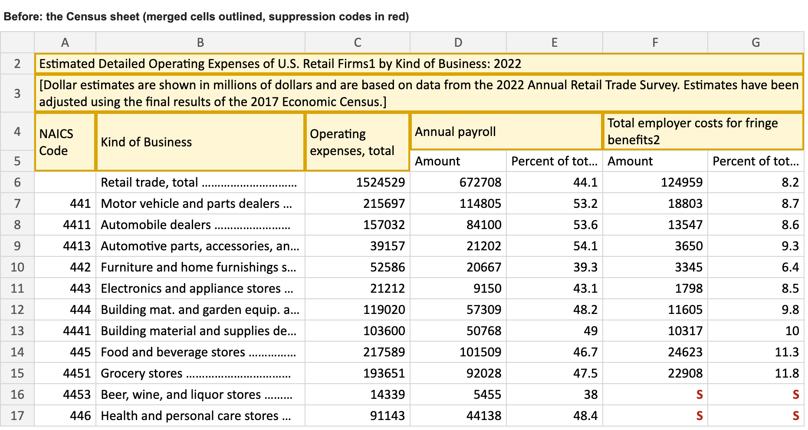
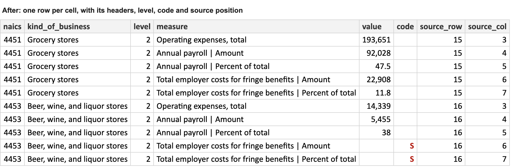

# merged-cells-reader

Turns print-style spreadsheets into one tidy table that ties back to the source.





Government and finance tables are often built to be printed, not analyzed: titles and headers in merged cells, labels padded with dot leaders, footnote numbers glued to words (`benefits2`), and letters where numbers should be (`S` means suppressed). This reads them into one long table where every number knows which cell it came from. The test case is three Census Bureau retail tables: sales, inventories and operating expenses.

## Run it

```
python -m venv .venv && .venv/bin/pip install -r requirements.txt
.venv/bin/python mcreader.py data
```

```
Detailed operating expenses of retailers (2022): 936 numbers out of 936
End-of-year retail inventories (2022 benchmarked): 961 numbers out of 961
Annual retail sales by kind of business (2022 benchmarked): 2139 numbers out of 2139
4783 rows -> output/2026-11-06/tidy.csv
```

Next to `tidy.csv`, a `qa/` folder holds the reconciliation (numbers in the sheet vs. numbers written out), every suppressed cell with what its code means, skipped rows, and the notes and footnotes pulled from the sheet. `config/tables.csv` sets the tab and ID columns for a file that needs them.

## Why it's built this way

- **Merged ranges come from the sheet's XML.** openpyxl's fast streaming mode can't see merged cells, but the XML lists them (`<mergeCell ref="D4:E4"/>`). On a 150,000-row export this was seconds instead of minutes.
- **No forward-fill.** A blank header cell is sometimes part of a merge and sometimes really blank. Copying each merged value across its actual range gets that right; filling from the left doesn't.
- **Level comes from the NAICS code, not the indentation.** The indents vary (three spaces here, four there); code length doesn't.
- **It stops before writing if anything doesn't reconcile.** Every number must appear exactly once in the output, and every letter code must be in the sheet's own legend. A file that half-worked is worse than one that failed.

## Limits

- It expects ID columns on the left and values to the right.
- Header detection is a rule of thumb. If a header row contains numbers, set the header rows by hand.

Data: U.S. Census Bureau, Annual Retail Trade Survey (public domain); `get_data.sh` downloads it again. MIT license.
